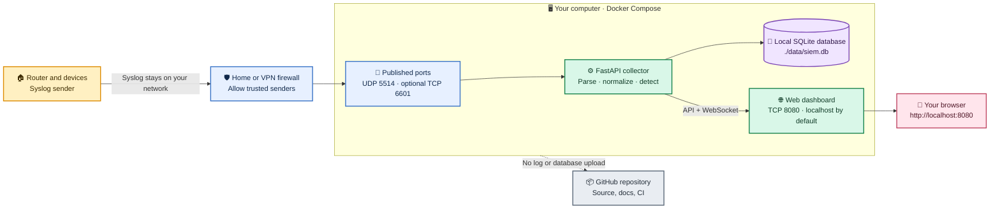

# 🏠 OpenHomeSIEM

**A private, self-hosted syslog collector and investigation dashboard for your home lab.**

[](https://github.com/iamHelios04/OpenHomeSIEM/actions/workflows/ci.yml)

OpenHomeSIEM receives syslog from your router and other devices, saves it in a local database, and shows events in a live web dashboard. Each installation is its own collector: your logs and database stay on the computer where you installed it.

> **Quick start:** Install Docker, clone or download this repository, then run the installer for your operating system. For now, use the **source-build** option because a tagged container image release has not been published yet.

## ✨ What you get

- 📥 Receive standard RFC 3164 and RFC 5424 syslog over UDP, with optional TCP support.
- 🔎 Search and review events, devices, alerts, investigations, and reports in a browser dashboard.
- ⚡ Stream new events and detections to the dashboard as they arrive.
- 🧠 Run local anomaly rules without sending log data to an AI service.
- 💾 Keep settings and the SQLite database on your own computer.
- 🐳 Run the same Docker Compose setup on Windows, macOS, and Linux.

## 🗺️ How it works

Each person runs a separate copy. GitHub provides the project files and, after a versioned release, may provide container images. **GitHub does not receive your syslog traffic or local database.**



## 🚀 Install it

### 1. Install the container software

| Computer | Install first |
|---|---|
| **Windows 10/11** | [Docker Desktop](https://docs.docker.com/desktop/setup/install/windows-install/). Start Docker Desktop and wait until it says Docker is running. |
| **macOS** | [Docker Desktop for Mac](https://docs.docker.com/desktop/setup/install/mac-install/). Choose the download for Apple silicon or Intel, then open Docker Desktop and wait until it is running. |
| **Ubuntu / Debian / other Linux server** | Install Docker Engine and the Docker Compose plugin using the [official Linux instructions](https://docs.docker.com/engine/install/). On Linux, your account must be able to run Docker; use `sudo` if you have not configured Docker access for your user. |

You do **not** need to install Python, Node.js, or a separate database for the normal Docker installation.

### 2. Get the project

**Option A — Git (recommended):** Install Git if your computer does not already have it, open a terminal, and run:

```sh
git clone https://github.com/iamHelios04/OpenHomeSIEM.git
cd OpenHomeSIEM
```

**Option B — ZIP:** On the GitHub repository page, select **Code → Download ZIP**, then extract the ZIP. Open a terminal in the extracted `OpenHomeSIEM` folder before running the installer. The folder contains the scripts and Compose files the installer needs.

### 3. Run the installer for your system

The source-build option builds the containers on your own computer. Use this option until a published versioned image is available.

<details>
<summary><b>🍎 macOS</b></summary>

Open **Terminal**, go to the project folder, and run:

```sh
cd OpenHomeSIEM
sh ./install.sh --source-build
```

If you already opened Terminal in the project folder, skip the `cd` line.

</details>

<details>
<summary><b>🪟 Windows</b></summary>

Open **PowerShell** in the project folder and run:

```powershell
.\install.ps1 -SourceBuild
```

Or double-click `install.cmd` from File Explorer, or run it in Command Prompt:

```bat
install.cmd -SourceBuild
```

If PowerShell says scripts are disabled, use `install.cmd -SourceBuild`; it launches the installer with the required process-level policy and does not change your system policy.

</details>

<details>
<summary><b>🐧 Linux desktop or server</b></summary>

From a terminal in the project folder:

```sh
sh ./install.sh --source-build
```

On Ubuntu Server, if your account does not have Docker access, run:

```sh
sudo sh ./install.sh --source-build
sudo docker compose ps
```

When you installed with `sudo`, use `sudo` for the later Docker commands and the start/stop scripts too.

</details>

The installer checks Docker, creates a private `.env` file with a random application key, creates the local `data/` folder, builds and starts the containers, and checks that the dashboard and API respond.

## ✅ Open it and check that it is running

On the computer running the collector, open **[http://localhost:8080](http://localhost:8080)**. The installer also checks the API at `http://localhost:8080/api/health`.

To see container status or logs, run these commands from the project folder:

```sh
docker compose ps
docker compose logs -f
```

Press **Ctrl+C** to stop viewing the logs; this does not stop the application.

### Start, stop, and update

| Task | Windows PowerShell | macOS / Linux |
|---|---|---|
| Start | `.\start.ps1` | `sh ./start.sh` |
| Stop | `.\stop.ps1` | `sh ./stop.sh` |
| View status | `docker compose ps` | `docker compose ps` |
| View logs | `docker compose logs -f` | `docker compose logs -f` |

You can also double-click `start.cmd` or `stop.cmd` on Windows. Stopping the containers keeps your settings and database. On Linux, add `sudo` to these commands if you installed with `sudo`.

When a published image release is available, update it from the project folder with `docker compose pull` followed by `docker compose up -d`. A source-built installation can update the code and rebuild by pulling the latest repository changes, then running its start script.

## 📡 Send logs from your router

The installer starts the collector listener, but **it does not change your router settings**. Configure your router separately to send remote syslog to the computer running OpenHomeSIEM.

| Setting | Default |
|---|---|
| Protocol and port | **UDP 5514** (recommended); optional TCP **6601** |
| Dashboard | TCP **8080**, bound to `127.0.0.1` by default |
| Internal container listener | UDP **514** and TCP **601** |

1. Give the collector computer a stable LAN address, ideally with a DHCP reservation in your router.
2. In your router's remote logging or syslog settings, enable syslog and enter the collector computer's **LAN IP address** and **UDP port 5514**. Choose TCP/6601 only if your sender supports TCP syslog.
3. Allow the selected syslog port through the computer or network firewall for trusted devices on your LAN.
4. Open the dashboard and select **View live events** to confirm messages arrive.

**Same home network:** Port forwarding on your internet router is usually not needed. The sender targets the collector's LAN IP.

**Sender outside your home:** Prefer a VPN between the sender network and the collector. Public UDP syslog is unencrypted and can be spoofed. If you still expose a syslog port to the internet, restrict the source addresses with a firewall. Do not expose the dashboard publicly. The default dashboard binding is local-only; access it remotely through a VPN or SSH tunnel.

For an SSH tunnel from your laptop to a Linux server, run this on the laptop:

```sh
ssh -L 8080:127.0.0.1:8080 USER@COLLECTOR_SERVER
```

Then open `http://localhost:8080` on the laptop while the SSH session stays connected.

### Time zone

RFC 3164 syslog timestamps do not include a time zone. The default is `Asia/Kolkata`. If the sender uses a different time zone, edit `SYSLOG_TIMEZONE` in the local `.env` file to match it, then restart OpenHomeSIEM.

## 🔐 Your logs and database

- Every installation creates its own `.env` and local SQLite database at `data/siem.db`.
- Logs are stored on the collector computer. They are not automatically sent to GitHub or to other users' installations.
- `.env` contains your private application key. Keep it and the `data/` folder private; both are excluded from Git.
- To back up an installation, stop it and securely copy both `.env` and `data/`. Restore those files into the new project folder before starting the app.
- To start with a completely fresh database, stop the app and back up or remove the local `data/` folder. This deletes that installation's stored logs.

## ⚙️ Common settings

Edit the local `.env` file in a text editor, then restart the containers for changes to take effect.

| Variable | Default | What it controls |
|---|---|---|
| `WEB_PORT` | `8080` | Browser dashboard port. |
| `WEB_BIND_IP` | `127.0.0.1` | Dashboard network binding. Keep local-only on internet-facing servers. |
| `SYSLOG_UDP_PORT` | `5514` | Host UDP port for router and device logs. |
| `SYSLOG_TCP_PORT` | `6601` | Optional host TCP syslog port. |
| `SYSLOG_TIMEZONE` | `Asia/Kolkata` | Time zone used to interpret RFC 3164 timestamps. |
| `MAX_LOG_RETENTION_DAYS` | `90` | Retention period before old records are archived and removed. |
| `IMAGE_TAG` | `latest` | Container image release to use after a tagged image has been published. |
| `BUILD_FROM_SOURCE` | `false` | Use the local source-build Compose overlay when set to `true`. The installer flag sets this automatically. |

If a port is already in use, change its matching variable in `.env`, restart, and update the router's destination port if you changed a syslog port.

## 🧰 Troubleshooting

| Problem | Check |
|---|---|
| Installer says Docker is not running | Open Docker Desktop on Windows/macOS. On Linux, check that Docker Engine is running and your account can access it. |
| Dashboard does not open | Run `docker compose ps` and `docker compose logs --tail=100`. Confirm that port 8080 is available or change `WEB_PORT` in `.env`. |
| No logs appear | Confirm the sender's destination IP, UDP/TCP protocol, port, host firewall, and that the router's remote syslog feature is enabled. |
| Logs appear with the wrong time | Set `SYSLOG_TIMEZONE` in `.env` to the sender's time zone and restart. |
| Container image pull fails | A published image may not exist yet. Install using the source-build option shown above. |
| SQLite database will not open | Ensure the project folder is writable and that `data/` exists. |
| Need more detail | Run `docker compose logs -f` in the project folder. |

Docker-published ports can interact differently with host firewalls, particularly UFW. Do not rely on a basic UFW rule alone to restrict a public Docker-published port; use a VPN or a firewall rule that filters traffic before it reaches the container.

## 🧑‍💻 For developers

The backend is FastAPI and the frontend is React. GitHub Actions validates the Compose configuration, builds both containers, starts the app, and checks the API health endpoint on pushes and pull requests. A maintainer can publish multi-platform `linux/amd64` and `linux/arm64` images by pushing a version tag such as `v1.0.1`. Published GHCR packages must be public for unauthenticated installs.

For a local non-Docker development setup, use Python 3.11+ for the backend and Node.js for the frontend. The API is served on port 8000 and Vite on port 5173; see the `backend/` and `frontend/` folders for dependencies and project configuration.

## 📄 License

No license is granted. All rights are reserved; public visibility of this repository does not grant permission to reuse, modify, or distribute the source.
